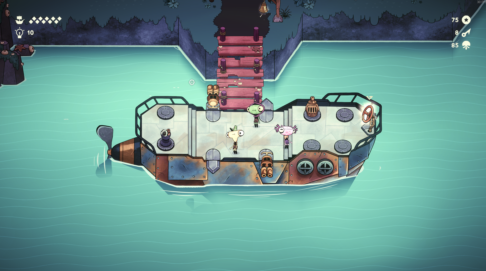
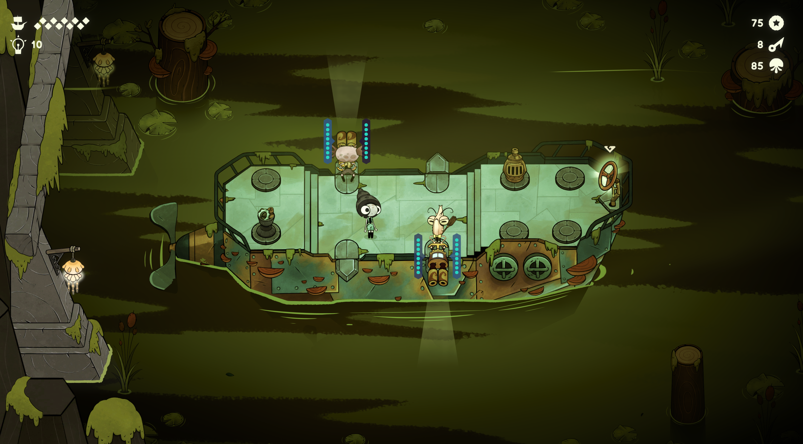

# Ship of Fools — 3 Player Mod

Play local co-op with three people! The third player joins as a copy of player
two and uses their own gamepad.

**[Download the mod](dist/Ship-of-Fools-3-Player-Mod-0.5.0.zip?raw=true)** · Windows / Steam 1.5.4 · Mod version 0.5.0

## Install

1. Close the game and download the ZIP above.
2. In Steam, right-click **Ship of Fools → Manage → Browse local files**.
3. Open the downloaded ZIP and extract **everything inside it** into that game
   folder. You should see **Install.cmd** beside **ShipOfFools.exe**.
4. Double-click **Install.cmd**. When it says the mod is installed, start the
   game normally.

You don't need to install any extra software. If Steam already updated your game
from 1.5.3, run this installer directly.

Using After the Storm too? Install **Siren Update 1.2** first, then install the
3 Player Mod. To remove After the Storm later, uninstall the 3 Player Mod first.

## Play with three people

- Join two players and choose your characters as usual.
- Once you're on the island, press a face button on the spare gamepad.
- The third character appears beside player two. Move apart to see both!
- Player two can change character on the island!
- Each player has its own inventory!

Use three gamepads, or a keyboard/mouse and two gamepads.

## A few things to know

- This is an experimental mod. Character selection and some menus still have
  only two player slots. Player three starts with player two's chosen character. Player two can change the character on the island.
- **Player three's items aren't saved separately.** Put valuable items on the
  ship before quitting.
- This adds a third player for local play. Online play is not supported.
- The installer checks that your game is compatible. If it says your version
  isn't supported, check this project for an update.

## Uninstall

Close the game, then double-click **Uninstall.cmd** in the game folder.

Still on Steam 1.5.3? Use the [0.4.0 ZIP](dist/Ship-of-Fools-3-Player-Mod-0.4.0.zip?raw=true).

## Need help?

See the [short troubleshooting guide](TROUBLESHOOTING.md), or open an issue here
with what happened and which controllers you use.

## Screenshots

---

Unofficial mod; not affiliated with the game's developers or publisher.
[License](LICENSE) · [For developers](CONTRIBUTING.md) · [Release instructions](RELEASING.md)
